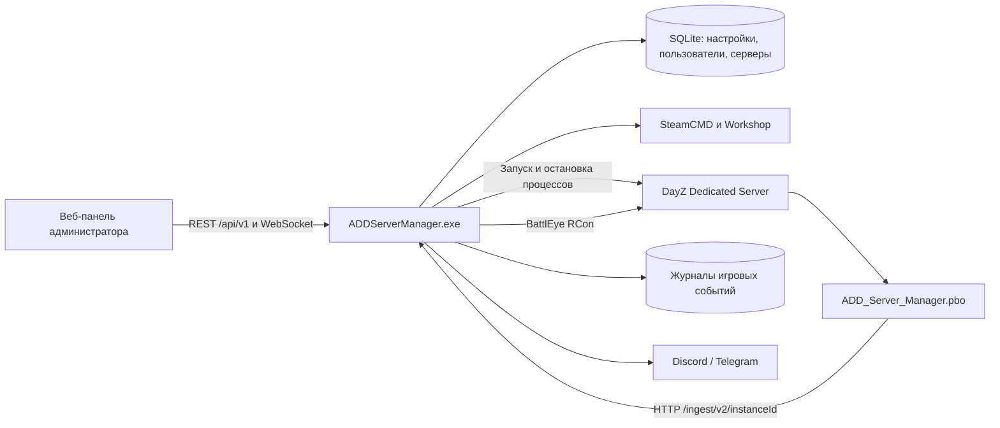

# ADD Server Manager v0.9.91 — индекс проекта

Разбор выполнен 19 октября 2026 года для upstream-тега `v0.9.91`, коммит `6fb0459ede231306facfbf10a4cbd11b197a7462`. Рабочая ветка форка — `develop`.

## Навигация

- [Восстановление из distr: результаты и ограничения](docs/SOURCE_RECOVERY.md).
- [Встроенная панель целиком и исходные SQL-миграции](reference/v0.9.91/embedded/).

- [Конфигурация: файлы, секции и значения полей](docs/CONFIGURATION.md).
- [Исходники игровой части, извлечённые из PBO](reference/v0.9.91/game-mod/).
- [Собранные JS/CSS веб-панели, извлечённые из EXE](reference/v0.9.91/web-assets/assets/).
- [Типы и поля конфигурации Go, извлечённые из EXE](reference/v0.9.91/go-types.json).
- [Зависимости и параметры сборки EXE](reference/v0.9.91/go-build-info.txt).
- [Имена исходных Go-файлов из EXE](reference/v0.9.91/go-source-paths.txt). Это список путей, а не содержимое исходников.
- [Состав и SHA-256 файлов PBO](reference/v0.9.91/pbo-manifest.json), [состав JS/CSS](reference/v0.9.91/web-manifest.json), [SHA-256 релизных файлов](reference/v0.9.91/release-assets.json).
- [Скрипт воспроизводимого извлечения](tools/extract_release.py).
- [Готовая сборка в нашем форке](https://github.com/IlyaIKalin/ADD-Server-Manager/releases/tag/v0.9.91).
- [Исходный релиз автора](https://github.com/K-aBa-N/ADD-Server-Manager/releases/tag/v0.9.91).
- [Оригинальный README](README.md), [лицензия репозитория](LICENSE).

## Что доступно для разработки

| Материал | Где находится | Что это означает |
| --- | --- | --- |
| Публичное Git-дерево автора | В теге и ветке `upstream/main` | Только `README.md` и `LICENSE`, два коммита; Go/Vue-проект и команды его сборки не опубликованы |
| `ADDServerManager.exe` | Раздел Releases | Готовая Windows amd64-программа; в нашем релизе размещена неизменённая копия автора |
| `ADD_Server_Manager.pbo` | Раздел Releases | Игровой мод, содержащий 35 читаемых файлов Enforce Script, два layout, XML ввода, CSV локализации и `config.bin` — всего 40 файлов |
| `reference/v0.9.91/game-mod` | Эта ветка | Побайтово извлечённое содержимое PBO; скрипты можно анализировать и изменять |
| `reference/v0.9.91/web-assets` | Эта ветка | 71 собранный JS/CSS-файл панели; это не исходный Vue-проект, нет `.vue`, `package.json`, lockfile и инструкции сборки |
| `go-types.json`, `go-build-info.txt` | Эта ветка | Метаданные исполняемого файла; позволяют подтвердить стек и имена полей, но не заменяют Go-исходники |
| Source code.zip / tar.gz на GitHub | Автоматические архивы тега | Содержимое Git-тега, а не распакованный EXE/PBO; архив исходного `v0.9.91` содержит README и LICENSE |

GitHub-форк не копирует релизные вложения автоматически. EXE и PBO отдельно перенесены в релиз нашего форка. Документация и извлечённые файлы добавляются в `develop`; исторический тег `v0.9.91` остаётся на исходном коммите.

Полный менеджер из текущего Git-дерева пересобрать нельзя. Для этого нужны исходники backend, исходники frontend, зависимости и сценарии сборки автора. Содержимое PBO и JS/CSS извлечено статически: приложение не запускалось, игровые серверы не устанавливались.

## Важное расхождение с README

Оригинальный README описывает Node.js / Express / TypeScript / Angular и `settings.cfg`. Проверенный EXE этого релиза содержит другую реализацию:

| Часть | Подтверждено по релизу v0.9.91 |
| --- | --- |
| Backend | Go; точка сборки `addsm/cmd/addsm`, Windows amd64, `CGO_ENABLED=0` |
| HTTP / API | `go-chi/chi/v5`, Huma v2; панель использует `/api/v1` |
| WebSocket | `github.com/coder/websocket` |
| База данных | `modernc.org/sqlite`; миграции через `pressly/goose/v3` |
| Планировщик | `robfig/cron/v3` |
| Метрики процессов | `shirou/gopsutil/v4`, Windows WMI |
| Служба Windows | `kardianos/service`, собственные модули `winservice` и `serviceright_windows` |
| Панель | Vue runtime и компоненты Vue, Naive UI; собранные ассеты, Leaflet и uPlot |
| Начальная сетевая конфигурация | `config.yaml`; поля подтверждены Go-тегами `yaml` |
| Игровой мод | Enforce Script, версия `0.9.91`, протокол `2` |

Список зависимостей получен из Go build info. Имена `.go` сохранились в бинарном файле, но тела функций не восстановлены. Версия компилятора в метаданных — `go1.27.1`; это значение файла, не требование к сборке, проверенное нами. Сборка содержит `vcs.modified=true`, поэтому совпадение бинарника с опубликованным Git-тегом по исходному коду подтвердить нельзя.

## Как устроена система



Панель работает в браузере. Менеджер управляет процессами Windows, данными, обновлениями и задачами. RCon обеспечивает стандартные действия BattlEye. Игровой мод добавляет сведения и команды, которых недостаточно получить через RCon: позиции, здоровье, инвентарь, объекты мира, события и отчёты игроков.

Встроенная панель указывает, что ingest-порт слушает `127.0.0.1`. Мод по умолчанию обращается к `http://127.0.0.1:8082`. Это схема для менеджера и сервера DayZ на одной Windows-машине. Адрес самой панели настраивается отдельно через `listenHost`, `listenPort` и TLS; утверждение старого README «только localhost» не следует применять ко всем настройкам этой сборки.

### Словарь

| Термин | Значение |
| --- | --- |
| Инстанс | Один управляемый сервер DayZ: идентификатор, каталог, порты, конфиг, список модов и расписания |
| Workshop ID | Числовой идентификатор мода Steam, не локальное имя папки `@mod` |
| Client mod | Мод, добавляемый в клиентский список запуска `-mod` |
| Server mod | Серверный мод из списка `-serverMod` |
| Query port | Порт опроса состояния игрового сервера; отличается от игрового и RCon-порта |
| RCon | Канал административных команд BattlEye; требует своего порта и пароля |
| Ingest | Приём менеджером событий и снимков состояния от игрового мода |
| Heartbeat | Периодическое сообщение, что игровой сервер и мод работают |
| Snapshot | Полный снимок отслеживаемых объектов; дополняется изменениями между снимками |
| Journal | История игровых событий, не обычный текстовый `.log` |
| Spool / spill | Очередь на диске, куда выгружаются данные, не помещающиеся в очередь памяти или ожидающие отправки |
| Affinity mask | Битовая маска разрешённых процессорных ядер; настройки процесса менеджера и сервера раздельные |
| Cron | Расписание: минута, час, день месяца, месяц, день недели |
| DPAPI | Используемое Windows-хранилищем приложения шифрование секретов с привязкой к учётной записи |

## Возможности и где они реализованы

| Возможность | Подтверждение в извлечённых материалах |
| --- | --- |
| Создание, импорт и копирование серверов; запуск, остановка, настройка портов | `NewInstanceView`, `DashboardView`, `ManagerTab`, имена Go-модулей `instances`, `runtime` |
| Управление SteamCMD, игрой, модами и очередью операций | `ComponentsView`, `SteamConsoleView`, `ModsView`, `ModsTab`; Go-модули `components`, `mods`, `workshop`, `jobs` |
| Настройки `serverDZ.cfg` и файлов миссии | `ConfigTab`, `ToolsTab`; `instances/serverdz.go`, `tools/mission.go` и `tools/files.go` |
| Перезапуски по cron, предупреждения, обновления, защита от частых падений | `ManagerTab`, поля `settings.Server` / `settings.Updates`, модуль `restart` |
| Метрики и графики нагрузки | `MetricsChart`, `OverviewTab`; `runtime/metrics.go`, `runtime/health.go` |
| Игроки, баны, whitelist, история и GeoIP | `PlayersView`, `PlayersTab`, модуль `players` |
| Карта игроков, транспорта и объектов | `LiveTab`, Leaflet; `ADD_Positions.c`, `ADD_EntityRegistry.c`, `ADD_EntitySnapshots.c` |
| Журнал боя, предметов, стройки, транспорта и сессий | `JournalTab`, `JournalList`; файлы `Journal/*.c`, `Combat/*.c`, `World/*.c` |
| Отчёты игроков из игры | `ReportsTab`, `ADD_ReportRpc.c`, `ADD_ReportMenu.c`, layout отчёта |
| Уведомления Discord/Telegram | Поля секретов панели, `settings.Notifications`, Go-модуль `notify` |
| Пользователи, роли, доступ к серверам, API-токены, 2FA и сессии | `UsersView`, `ProfileView`, `LoginView`; Go-модуль `auth` |
| Аудит действий и фоновые задачи | `AuditView`, `JobsView`; модули `auth/audit.go`, `platform/jobs` |
| TLS, установка службы Windows и резервные копии БД | `SettingsView`, `SetupView`, типы `config.TLS` и `settings.Backups` |

Наличие пунктов UI и кода подтверждено статически. Их работоспособность на Windows и совместимость с конкретной сборкой DayZ в этом исследовании не проверялись.

### Административные команды игрового мода

В [ADD_CommandExecutor.c](reference/v0.9.91/game-mod/Scripts/4_World/ADD_Server_Manager/Commands/ADD_CommandExecutor.c) есть обработка:

- игроки: `heal`, `kill`, `kick`, `teleport`, `spawn_item`, `inventory`, `inventory.restore`;
- объекты: `entity.teleport`, `entity.kill`, `entity.delete`;
- транспорт: `vehicle.spawn`, `vehicle.repair`, `vehicle.refuel`, `vehicle.parts`, `vehicle.delete`, `vehicle.set_fluid`;
- мир: `time`, `weather`, `request_snapshot`;
- память ключ/значение: `kv.set`, `kv.delete`.

Команды имеют `id`, `type` и `params`; мод отправляет подтверждение выполнения с результатом или ошибкой. `kv.set` хранит значения в статической карте скрипта: постоянное хранение после перезапуска этим кодом не обеспечивается. Точные формы REST-запросов нужно брать из API запущенной версии, а не выводить только из названий команд.

## Карта игровой части

| Каталог | Назначение |
| --- | --- |
| `Scripts/3_Game/.../Core` | Версия, bootstrap-конфиг, JSON, идентификаторы, часы и логирование |
| `Scripts/3_Game/.../Transport` | HTTP, публикация пачек, повторы, очередь памяти и spool на диске |
| `Scripts/4_World/.../Combat` | Классификация и перехват событий боя |
| `Scripts/4_World/.../Commands` | Выполнение команд менеджера в мире DayZ |
| `Scripts/4_World/.../Journal` | Действия, предметы, здоровье, стройка и транспорт |
| `Scripts/4_World/.../Players` | Steam ID, сессии, присутствие и координаты |
| `Scripts/4_World/.../Server` | Heartbeat и общий ticker |
| `Scripts/4_World/.../World` | Реестр объектов, снимки, изменения и чат |
| `Scripts/5_Mission` | Запуск на сервере, опрос команд, игровой экран отчётов |
| `GUI/layouts`, `Data/inputs.xml`, `stringtable.csv` | Интерфейс, ввод и локализация |
| `config.bin` | Скомпилированный конфиг PBO; текстового `config.cpp` автор в архив не положил |

При создании dedicated-миссии мод планирует запуск через две секунды. Затем читает bootstrap, запрашивает конфиг у менеджера, запускает heartbeat, присутствие, позиции и опрос команд. При завершении миссии отправляет/сохраняет остаток очереди. См. [ADD_MissionServer.c](reference/v0.9.91/game-mod/Scripts/5_Mission/ADD_Server_Manager/ADD_MissionServer.c).

PBO содержит также `MissionGameplay`, RPC и GUI отчётов. Поэтому нельзя без проверки считать его исключительно серверным модом: для клиентских функций нужно проверить требуемый состав установки на Windows/DayZ.

## Хранение и конфигурация

Конфигурация разделена на четыре уровня: сеть менеджера в `config.yaml`; общие настройки менеджера через API/SQLite; настройки конкретного инстанса и `serverDZ.cfg`; bootstrap и параметры игрового мода. Подробные поля и примеры находятся в [CONFIGURATION.md](docs/CONFIGURATION.md).

По встроенным SQL-строкам EXE подтверждаются таблицы `settings(section, data)`, `secrets(key, blob, updated_at)`, `instances` и `instance_settings`. Панель сообщает о `manager.db`, `player.db` и отдельных журналах `data/journal/<id>.db`. Устаревшее описание «все настройки в settings.cfg» к этой сборке не подходит.

Для службы Windows панель просит пароль учётной записи Windows, а не PIN. Встроенная подсказка объясняет: служба запускается от той же учётной записи, чтобы расшифровывать сохранённые секреты. Это важно при переносе менеджера на другую машину или запуске под другим пользователем.

## Как воспроизвести исследование

Скачайте оба файла из исходного релиза в отдельный каталог. Из корня репозитория выполните:

```bash
python3 tools/extract_release.py /path/to/downloaded-assets /tmp/addsm-reference
```

Скрипт сначала проверяет фиксированные SHA-256 релиза. Затем извлекает PBO без изменения содержимого, встроенные JS/CSS и Go-метаданные. Он не запускает EXE, не устанавливает SteamCMD и не декомпилирует backend в Go. Каталог `web-assets` содержит только извлечённые JS/CSS. Дополнительный каталог `embedded/dist` содержит также HTML, иконки и шрифты; `embedded/migrations` — четыре исходные SQL-миграции. Исходные Vue-компоненты этим инструментом не восстанавливаются; панель требует совместимого backend.

Для сравнения с материалами ветки:

```bash
diff -r reference/v0.9.91 /tmp/addsm-reference
```

## Что нужно для параллельной разработки

1. Для изменения игровой части использовать извлечённые `.c` как отправную точку; перед сборкой восстановить/декодировать `config.cpp`, сохранить PBO prefix `ADD_Server_Manager` и проверить клиентскую часть отчётов.
2. Для полноценного развития менеджера получить у автора Go-модули `cmd`, `internal`, `go.mod` / `go.sum`, исходный frontend с зависимостями и сценариями сборки. SQL-миграции и встроенная панель уже извлечены. Имена путей в EXE не заменяют содержимое Go-файлов.
3. Разрабатывать в `develop`, не перемещать исходный тег `v0.9.91`. Изменения игрового мода и backend сверять с протоколом `2`, форматом команд и JSON-конфигурации.
4. Проверять интеграцию на отдельном Windows-инстансе DayZ. Публикуемые здесь EXE/PBO пока являются оригинальной сборкой автора, а не результатом сборки нашего форка.
